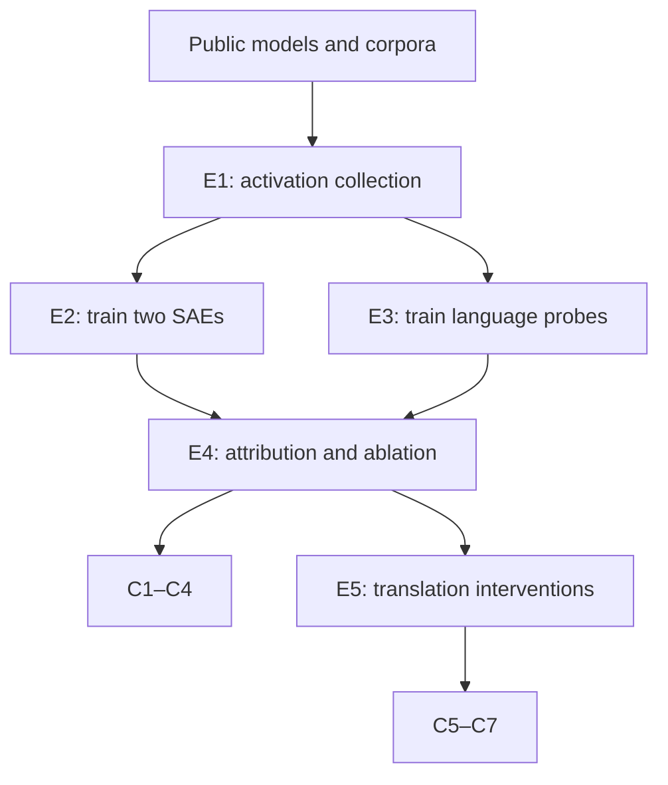

# Reproduction-cost analysis: *Large Language Models Share Representations of Latent Grammatical Concepts Across Typologically Diverse Languages*

**Estimate date:** 2 September 2026  
**Scope:** Minimal credible reproduction of the paper's evidential backbone. These are current reproduction estimates, not the authors' historical accounts.

## A. Paper metadata

- **Paper:** *Large Language Models Share Representations of Latent Grammatical Concepts Across Typologically Diverse Languages*
- **Authors:** Jannik Brinkmann, Chris Wendler, Christian Bartelt, and Aaron Mueller
- **Venue/year:** NAACL 2025, pages 6131–6150
- **Paper:** [ACL Anthology](https://aclanthology.org/2025.naacl-long.312/)
- **Preprint:** [arXiv:2501.06346](https://arxiv.org/abs/2501.06346)
- **Code, data, and SAE links:** [GitHub repository](https://github.com/jannik-brinkmann/multilingual-features)
- **Spreadsheet provenance:** Sample paper 1 in the NAACL row.

## B. Executive direct-expense estimate

| Estimate | Direct expenses |
|---|---:|
| **Low** | **$215** |
| **Central** | **$620** |
| **High** | **$1,800** |

The dominant expense is GPU rental. The central reconstruction uses **1,120 RTX A6000 GPU-hours**: 960 for model-activation collection, two sparse-autoencoder trainings, and probes; 160 for attribution, ablations, validation, and translation steering. Public models, datasets, code, annotations, and software have zero acquisition cost.

## C. Tweet-sized summary

Reproducing *Large Language Models Share Representations of Latent Grammatical Concepts* costs about **$620 directly** ($215–$1,800), mostly GPU rental. Human work covers multilingual data design, probe validation, feature inspection, interventions, and interpretation.

## D. Important conclusions and grounding artifacts

| ID | Important conclusion | Grounding artifacts |
|---|---|---|
| C1 | Llama-3-8B and Aya-23-8B contain SAE features shared across languages for the same morphosyntactic concepts. | Per-language logistic probes; integrated-gradient attribution scores; top-32 feature sets; intersection-over-union values; Figure 2. |
| C2 | Some individual features activate on the same concept across typologically diverse languages. | Token-level activation examples for plural nouns and past tense; Figure 3; manually inspected feature patterns. |
| C3 | The most multilingual features causally support probe predictions. | Feature-ablation experiment; baseline and post-ablation probe accuracy; Figure 4. Llama-3 probe accuracy falls to 64% after ablating the top quartile of massively multilingual features and 61% after ablating all multilingual features. |
| C4 | Multilingual features are relatively concept-specific. | Pairwise overlap among concept-value feature sets; mean overlap 13.9% ± 10.7%; high-overlap linguistic cases. |
| C5 | Single-feature interventions can change grammatical properties during translation. | Counterfactual translation dataset; 64 examples per setting; generation with and without intervention; probe-based flip rates; Figure 5. |
| C6 | These interventions usually avoid changing unrelated grammatical concepts. | Probe predictions for non-target concepts; selectivity proportions by language and feature; Figure 6. |
| C7 | The causal behavior generalizes beyond synthetic templates, imperfectly. | Qualitative Flores-101 translations; Figure 7; recorded failures and degenerate generations. |

## E. Evidential dependency map

E1 is shared across SAE training and probe work. E2 and E3 jointly enable the attribution analysis. The same probes evaluate ablations, intervention efficacy, and selectivity. Each shared activity is charged once.

## F. Unique experiments and production activities

### E1. Multilingual data preparation and activation collection

Download Llama-3-8B, Aya-23-8B, Universal Dependencies data for 23 languages, The Pile samples, mC4 samples, and Flores-101. Extract layer-16 residual-stream activations. The main SAE training stream contains **250 million tokens per model**. The paper also records maximum feature activations across **20 million mC4 tokens** for steering.

### E2. Train two gated sparse autoencoders

Train one gated SAE for each 8B model. The reported expansion factor is eight, batch size is 512, learning rate is 0.001, warmup is 1,000 steps, and each SAE consumes 250 million activation tokens. Validate reconstruction quality on nine mC4 languages. This activity creates the feature dictionaries used by every headline analysis.

### E3. Train morphosyntactic probes

For every eligible language and concept-value combination, sum non-padding layer-16 token activations and fit logistic regression classifiers. Retain concepts annotated in at least six languages. These classifiers define the target metrics for feature attribution and later evaluate steering efficacy and selectivity.

### E4. Attribute, compare, and ablate features

Use integrated-gradient attribution patching with ten interpolation points. Rank SAE features for each probe. Select each probe's top 32 features. Calculate cross-language intersections, feature-language distributions, and concept overlap. Then ablate monolingual, multilingual, and massively multilingual feature sets and reevaluate the existing probes.

### E5. Translation steering

Adapt and translate counterfactual templates for tense, gender, and number. Use English, French, German, and Turkish, excluding Turkish gender. Retain cases where Llama-3-8B predicts the grammatical continuation. Manually select interpretable features and tune activation multipliers. Generate paired translations with and without interventions. Measure target-label flips, non-target stability, and selected Flores-101 examples.

## G. Smallest reasonable reproduction set

The reconstruction retains both models because C1 explicitly compares English-heavy and multilingual pretraining. It retains both SAE trainings because downloaded author checkpoints would verify downstream code but would not reproduce the feature-production activity underlying the evidence. It retains all 23 UD languages, the three major concept families, ablations, and translation steering.

The following are omitted:

- Repeated SAE seeds, since the paper reports one dictionary per model.
- New model pretraining, since both base models are public inputs.
- New UD annotation, since treebanks already contain labels.
- Exhaustive Flores evaluation, since evidence is qualitative.
- Conference registration and publication costs.
- Abandoned feature choices and unrelated exploratory analyses.

## H. Direct-expense ledger

| Activity | Resource quantity | Low | Central | High | Grounding |
|---|---:|---:|---:|---:|---|
| E1–E3: activations, SAE training, probes | 576 / 960 / 1,344 A6000 GPU-hours | $178.56 | $508.80 | $1,464.96 | Paper reports eight RTX A6000 GPUs and less than one week. |
| E4–E5: attribution, ablations, steering | 80 / 160 / 256 A6000 GPU-hours | $24.80 | $84.80 | $279.04 | Inferred from repeated 8B forward/backward passes and generations. |
| Temporary storage and checkpoints | 300–800 GB during project | $10 | $25 | $50 | Reasoned cloud-storage allowance. |
| Public models and datasets | Llama, Aya, UD, Pile, mC4, Flores | $0 | $0 | $0 | Public downloads; processing remains costly. |
| Software | Python, PyTorch, nnsight, scikit-learn | $0 | $0 | $0 | Open-source. |
| APIs | None | $0 | $0 | $0 | Models run locally on rented GPUs. |
| Participants and annotation | None newly recruited | $0 | $0 | $0 | Existing annotations and researcher inspection suffice. |
| **Total** |  | **$213.36 ≈ $215** | **$618.60 ≈ $620** | **$1,794.00 ≈ $1,800** |  |

## I. Detailed arithmetic

### Runtime bounds

The paper's Appendix A states that experiments used one server with **eight NVIDIA RTX A6000 48 GB GPUs** and an AMD EPYC 7413 CPU. Probe and autoencoder training took **less than one week**. It does not report the exact duration or separate downstream runtime.

I interpret this as:

- Low training case: `8 GPUs × 72 hours = 576 GPU-hours`
- Central training case: `8 GPUs × 120 hours = 960 GPU-hours`
- High training case: `8 GPUs × 168 hours = 1,344 GPU-hours`

I separately allow:

- Low downstream case: `80 GPU-hours`
- Central downstream case: `160 GPU-hours`
- High downstream case: `256 GPU-hours`

The high total equals `1,344 + 256 = 1,600 GPU-hours`.

### Current GPU prices

Three current market anchors define implementation quality:

- Low: [Vast.ai](https://vast.ai/pricing) lists A6000 instances from **$0.31/GPU-hour** and a $0.44 median.
- Central: [Runpod](https://www.runpod.io/gpu-models/rtx-a6000) lists RTX A6000 rental from **$0.53/GPU-hour**, updated 27 August 2026.
- High: [Lambda](https://lambda.ai/pricing) lists A6000 instances at **$1.09/GPU-hour**, including substantial CPU, RAM, and SSD capacity.

### Low

`(576 + 80) GPU-hours × $0.31 = 656 × $0.31 = $203.36`

`$203.36 + $10 storage = $213.36 ≈ $215`

### Central

`(960 + 160) GPU-hours × $0.53 = 1,120 × $0.53 = $593.60`

`$593.60 + $25 storage = $618.60 ≈ $620`

### High

`(1,344 + 256) GPU-hours × $1.09 = 1,600 × $1.09 = $1,744`

`$1,744 + $50 storage = $1,794 ≈ $1,800`

The central estimate uses the paper's exact GPU class. Migrating to H100s might reduce wall time, but uncertain scaling would make the estimate less auditable.

## J. Human-task breakdown

### Research design

- Define shared grammatical representations across languages.
- Choose contrasting English-heavy and multilingual models.
- Select comparable languages from Universal Dependencies.
- Choose concepts annotated across enough languages.
- Define causal evidence beyond correlational probe accuracy.

### Data preparation

- Download models, corpora, and treebanks.
- Match language codes across datasets.
- Filter sentences containing required grammatical labels.
- Pool subword activations into sentence representations.
- Translate counterfactual templates into selected languages.
- Check translations preserve intended grammatical contrasts.

### Infrastructure and implementation

- Configure eight GPUs and compatible CUDA libraries.
- Implement activation extraction at layer sixteen.
- Train gated sparse autoencoders for both models.
- Train probes for every language-concept combination.
- Monitor losses, sparsity, and reconstruction quality.
- Repair failed jobs and corrupted intermediate files.
- Save reproducible checkpoints and derived datasets.

### Feature analysis

- Implement integrated-gradient attribution patching.
- Rank features influencing each trained probe.
- Compare feature sets across languages.
- Measure feature overlap across grammatical concepts.
- Inspect multilingual activation examples manually.
- Reject features with unclear activation patterns.

### Causal validation

- Design monolingual and multilingual ablation conditions.
- Measure probe accuracy after each ablation.
- Check massively multilingual features explain performance.
- Select interpretable features for translation interventions.
- Tune intervention strengths across concepts and languages.
- Generate translations with matched control runs.
- Measure efficacy using existing grammatical probes.
- Check unrelated concepts remain unchanged.
- Inspect failed and degenerate generations.
- Test selected interventions on natural Flores sentences.

### Interpretation

- Compare Llama and Aya feature-sharing patterns.
- Separate causal findings from qualitative interpretation.
- Identify morphology-driven feature overlaps.
- Evaluate alternative language-specific explanations.
- State steering failures and methodological limitations.
- Decide which conclusions survive robustness checks.

## K. Uncertainty

1. **Exact runtime is unreported.** “Less than a week” strongly bounds training but leaves a wide interval.
2. **GPU utilization is unknown.** The server had eight GPUs, but every stage may not saturate all eight.
3. **Downstream runtime is reconstructed.** Attribution uses ten integrated-gradient points and many probes, while translation uses repeated 8B generations. The paper provides no wall-clock split.
4. **Storage pricing is approximate.** Pod storage, checkpoint retention, and dataset caching differ across providers. It is minor beside compute.
5. **Released SAEs create a cheaper verification route.** Downloading the two public dictionaries could eliminate most training cost. That would test downstream conclusions for roughly $40–$150, but would not reproduce feature learning.
6. **Manual inspection has no direct-expense charge.** It appears only in the human-task breakdown.
7. **No repeated seed is included.** Adding three SAE seeds would nearly triple the dominant cost.

## L. Final interpretation

A competent team reproducing the evidential backbone today would likely spend about **$620 in direct expenses**, with a credible range of **$215–$1,800**. GPU compute overwhelmingly dominates. The paper's own infrastructure statement constrains the estimate: eight RTX A6000 GPUs for under one week, plus smaller downstream intervention workloads.

The cash requirement remains modest because models, treebanks, corpora, code, annotations, and software are public. The difficult work is human: constructing valid multilingual comparisons, validating probes and SAEs, identifying meaningful features, designing causal interventions, and interpreting imperfect steering behavior.

## Sources

- [ACL Anthology paper](https://aclanthology.org/2025.naacl-long.312/)
- [Paper repository](https://github.com/jannik-brinkmann/multilingual-features)
- [Runpod RTX A6000 pricing](https://www.runpod.io/gpu-models/rtx-a6000)
- [Vast.ai live GPU pricing](https://vast.ai/pricing)
- [Lambda GPU pricing](https://lambda.ai/pricing)

