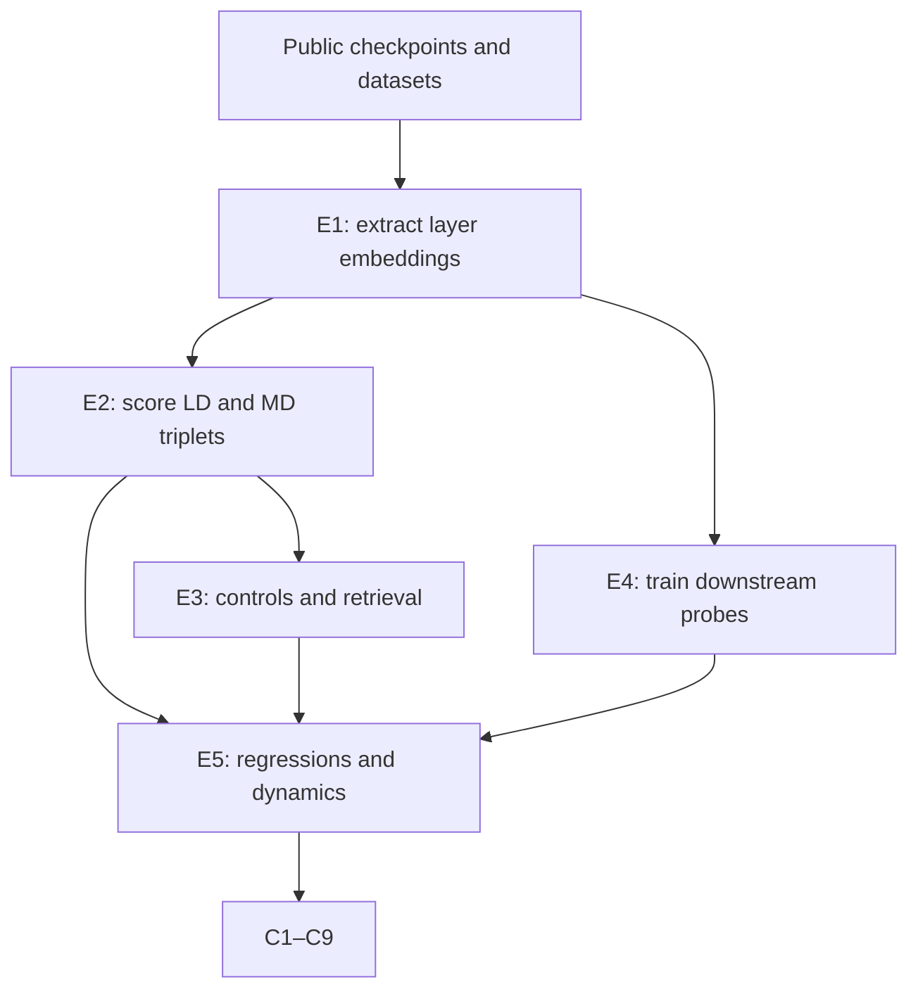

# Reproduction-cost analysis: *Discriminating Form and Meaning in Multilingual Models with Minimal-Pair ABX Tasks*

**Estimate date:** 2 September 2026  
**Scope:** Minimal credible reproduction of the paper's evidential backbone. These are current reproduction estimates, not the authors' historical accounts.

## A. Paper metadata

- **Paper:** *Discriminating Form and Meaning in Multilingual Models with Minimal-Pair ABX Tasks*
- **Authors:** Maureen de Seyssel, Jie Chi, Skyler Seto, Maartje ter Hoeve, Masha Fedzechkina, and Natalie Schluter
- **Venue/year:** EMNLP 2025, pages 23704–23725
- **Paper:** [ACL Anthology](https://aclanthology.org/2025.emnlp-main.1210/)
- **Preprint:** [arXiv:2505.17747](https://arxiv.org/abs/2505.17747)
- **Checkpoint source:** [XLM-R Across Time](https://nlp.cs.washington.edu/xlmr-across-time/)
- **Spreadsheet provenance:** Sample paper 1 in the EMNLP row.

## B. Executive direct-expense estimate

| Estimate | Direct expenses |
|---|---:|
| **Free-notebook route** | **$0** |
| **Low paid-cloud route** | **$30** |
| **Central paid-cloud route** | **$75** |
| **High paid-cloud route** | **$235** |

The minimal reconstruction can use a free Google Colab T4 and sequentially process the 39 public checkpoints. It requires approximately **25–110 T4 GPU-hours**, centrally about **55 hours**. A convenient paid-cloud reconstruction costs about **$75** centrally. The ABX comparisons themselves are large but vectorizable CPU work. No foundation-model training, commercial API, new annotation, or participant recruitment is required.

## C. Tweet-sized summary

Reproducing *Discriminating Form and Meaning in Multilingual Models with Minimal-Pair ABX Tasks* can cost **$0 directly** using free Colab, requiring roughly **55 T4 hours** (25–110). A convenient paid-cloud route costs about **$75**. Human work covers triplet design, validation, and interpretation.

## D. Important conclusions and grounding artifacts

| ID | Important conclusion | Grounding artifacts |
|---|---|---|
| C1 | Text ABX tasks can separately measure language identity and cross-lingual meaning. | Formal LD and MD triplet definitions; chance-baseline controls; approximately 100,000 triplets per pair and condition. |
| C2 | Language discrimination declines early, then partly recovers during XLM-R pretraining. | LD scores over 39 checkpoints, 630 language pairs, and all 13 representation levels; Figure 2. |
| C3 | Meaning discrimination improves steadily during pretraining. | MD scores over the same checkpoints, pairs, and layers; Figure 2. |
| C4 | Language information concentrates in lower layers, while meaning stabilizes deeper. | Final-checkpoint layer curves and joint checkpoint-layer heatmaps; Figures 3 and 4. |
| C5 | Form and meaning discrimination trade off, but not absolutely. | Pairwise checkpoint correlations: Spearman ρ = −0.74 overall; final-checkpoint correlations; layer correlations. |
| C6 | MD is a valid, controlled proxy for semantic alignment. | Cross-lingual WMT24 retrieval accuracy; Pearson r = 0.77 with ABX MD; chance controls. |
| C7 | Higher language discrimination predicts worse POS accuracy. | Six-seed monolingual POS probes; language-level LD/MD regressions; Table 1. |
| C8 | Higher pairwise language discrimination predicts worse POS and NER transfer. | Six-seed cross-lingual probes; source-target regression models; Table 1. |
| C9 | Meaning discrimination does not consistently predict downstream tasks. | NER, POS, and XNLI regressions; nonsignificant MD coefficients; Table 1. |

## E. Evidential dependency map

Embedding extraction is shared across ABX conditions and layers. LD and MD reuse the same sentence representations. The same final-checkpoint representations support retrieval and downstream probing. Figures and regressions transform stored outputs rather than rerunning encoders.

## F. Unique experiments and activities

### E1. Prepare data and extract XLM-R representations

Download the 39 public XLM-R-replica checkpoints, each approximately 3 GB. Download WMT24++, Universal Dependencies, Parallel UD, WikiAnn, and XNLI. Select the paper's 36 languages. For each checkpoint, mean-pool non-padding tokens at the embedding layer and all 12 transformer layers. Cache sentence representations for reuse.

The checkpoint source confirms **39 Fairseq checkpoints at 3 GB each**, or approximately **117 GB** before conversion and caching.

### E2. Construct and score ABX evaluations

For each of 630 unordered language pairs, create two tasks:

- Language discrimination holds meaning constant.
- Meaning discrimination holds language constant.

Sample approximately 100,000 triplets per task and pair. Compute cosine distances at each representation layer across 39 checkpoints. Aggregate pairwise, language-global, checkpoint, and layer scores.

The logical comparison count is:

`630 pairs × 2 tasks × 100,000 triplets × 39 checkpoints × 13 levels`

`= 63.882 billion triplet-level layer comparisons`

This does **not** mean 63.882 billion encoder calls. Representations are cached once, then indexed and compared in vectorized batches.

### E3. Validate ABX measurements

Construct control triplets where the target variable is constant. Confirm scores approach 0.5. At the final checkpoint, repeat ABX scoring on five random subsamples; the paper reports average standard deviation below 0.01. Compute bidirectional WMT24++ top-one retrieval and correlate it with MD.

### E4. Run downstream probing and transfer

Train independent language probes with early stopping and six random seeds. Include POS on UD, NER on WikiAnn, and NLI on XNLI. Evaluate monolingually, then evaluate cross-lingual transfer using the paper's 18-language POS/NER subset and 13 XNLI languages. Reuse cached encoder representations whenever the probe design permits.

### E5. Analyze dynamics and downstream relationships

Compute checkpoint curves, final-layer curves, joint heatmaps, and LD–MD correlations. Fit the reported regressions from LD and MD to monolingual and cross-lingual accuracy. Reproduce checkpoint-selection and source-language-selection comparisons supporting the diagnostic-use claims.

## G. Smallest reasonable reproduction set

The reconstruction retains all 39 checkpoints because temporal evolution is central. It retains all 36 languages and 630 pairs because broad multilingual behavior supports the framework's generality. It retains all layers because depth localization is a headline finding. It retains three downstream task families because their differences motivate the cautious conclusion about task relevance.

It excludes:

- Retraining XLM-R from scratch.
- Creating new WMT24++ translations.
- Reannotating UD, WikiAnn, or XNLI.
- Commercial APIs or hosted inference endpoints.
- Additional encoder architectures proposed as future work.
- Publication and conference costs.
- Exploratory analyses absent from the final evidence.

The public checkpoints are treated as free scientific inputs. Their inference and processing remain chargeable.

## H. Direct-expense ledger

| Activity | Resource quantity | Low | Central | High | Grounding |
|---|---:|---:|---:|---:|---|
| E1 and E4: embeddings and probes | 13 / 31 / 73 L4-equivalent GPU-hours | $3.12 | $15.19 | $94.17 | Derived from 25 / 55 / 110 T4-hours and plausible L4 speedups. |
| E2, E3, E5: vectorized comparisons | 100 / 250 / 600 CPU-server hours | $13.00 | $32.50 | $78.00 | 63.882B logical comparisons, batched locally. |
| Temporary storage | Checkpoints, conversions, cached embeddings | $10 | $25 | $60 | 117 GB raw checkpoints plus working data. |
| Public models and datasets | All acquisition | $0 | $0 | $0 | Research downloads are free. |
| APIs | None | $0 | $0 | $0 | Local open-model inference. |
| Participants and annotation | None newly collected | $0 | $0 | $0 | Existing datasets supply judgments and labels. |
| Software | PyTorch, Fairseq, Transformers, NumPy, scikit-learn | $0 | $0 | $0 | Open-source. |
| **Paid-cloud total** |  | **$26.12 ≈ $30** | **$72.69 ≈ $75** | **$232.17 ≈ $235** |  |
| **Free Colab total** | Free T4, existing laptop/storage | **$0** | **$0** | **$0** | No monetary charge; quota and interruptions remain constraints. |

## I. Detailed arithmetic

### GPU pricing

XLM-R base has 270 million parameters and fits comfortably on 24 GB GPUs. Current price anchors are:

- Low: [Vast.ai L4](https://vast.ai/pricing/gpu/L4) from **$0.20/hour**; I use the currently observed **$0.24/hour A10** configuration for a reproducible low on-demand case.
- Central: [Runpod L4](https://www.runpod.io/pricing) at **$0.49/hour** with 24 GB VRAM.
- High: [Lambda A10](https://lambda.ai/pricing) at **$1.29/hour** with 24 GB VRAM, substantial RAM, and SSD.

The paper does not report hardware or runtime. GPU-hour quantities are reasoned workload estimates, not author-reported usage. The earlier estimate based directly on triplet scale was too high: sampled triplets reuse the same sentence representations and therefore do not imply repeated XLM-R encoder calls.

Low:

`13 GPU-hours × $0.24 = $3.12`

Central:

`31 GPU-hours × $0.49 = $15.19`

High:

`73 GPU-hours × $1.29 = $94.17`

### CPU pricing

The CPU workload is dominated by cached-vector indexing, cosine comparisons, aggregation, and regressions. I use an effective **$0.13/server-hour** for an eight-vCPU European cloud instance, derived from Hetzner's current €0.1122 hourly listing and the ECB 1 September 2026 rate of €1 = $1.159.

Low:

`100 CPU-server hours × $0.13 = $13.00`

Central:

`250 CPU-server hours × $0.13 = $32.50`

High:

`600 CPU-server hours × $0.13 = $78.00`

### Totals

Low:

`$3.12 GPU + $13 CPU + $10 storage = $26.12 ≈ $30`

Central:

`$15.19 GPU + $32.50 CPU + $25 storage = $72.69 ≈ $75`

High:

`$94.17 GPU + $78 CPU + $60 storage = $232.17 ≈ $235`

### Free Google Colab reproduction

XLM-R base has 270 million parameters and fits comfortably on the 16 GB T4 commonly supplied by free Colab. The experiment does not train XLM-R. Each public checkpoint can be downloaded, evaluated, and deleted before processing the next one. All checkpoints therefore need not occupy memory or disk simultaneously.

A practical reconstruction divides T4 usage as follows:

- Representation extraction: **15–60 T4-hours**.
- Downstream probe preparation and execution: **5–30 T4-hours**.
- Controls, validation, and necessary reruns: **5–20 T4-hours**.

Total:

- Low: `15 + 5 + 5 = 25 T4-hours`.
- Central: approximately `30 + 15 + 10 = 55 T4-hours`.
- High: `60 + 30 + 20 = 110 T4-hours`.

The free route has **$0 direct GPU cost**. Google does not guarantee a particular free GPU or publish a fixed usage allowance. Free notebooks run for at most 12 hours and may terminate earlier. The workflow must therefore save results after every checkpoint and language batch.

The implementation should:

- Download one checkpoint at a time.
- Extract all thirteen representation levels together.
- Reuse each unique sentence representation across triplets.
- Save compressed representations after every checkpoint.
- Delete processed checkpoints before downloading replacements.
- Keep a manifest for interrupted-session recovery.

The 63.882 billion figure counts logical triplet-layer comparisons, not model executions. Those comparisons should use cached sentence vectors, integer indices, and vectorized cosine operations. Materializing every triplet would create an unnecessary storage and processing problem.

For comparison with the paid ledger, an L4 should require about 13–73 hours, centrally 31:

- Low: `25 T4-hours ÷ 2.0 = 12.5 ≈ 13 L4-hours`.
- Central: `55 ÷ 1.75 = 31.4 ≈ 31 L4-hours`.
- High: `110 ÷ 1.5 = 73.3 ≈ 73 L4-hours`.

## J. Human-task breakdown

### Research design

- Adapt speech ABX methods for multilingual text.
- Define language-discrimination triplets.
- Define meaning-discrimination triplets.
- Choose controls isolating each target variable.
- Select languages spanning families and scripts.
- Choose checkpoints revealing pretraining dynamics.
- Select downstream tasks testing different linguistic levels.

### Data preparation

- Download thirty-nine public model checkpoints.
- Convert checkpoints into compatible model formats.
- Download WMT24++, UD, WikiAnn, and XNLI.
- Match language codes across all resources.
- Filter languages missing required datasets.
- Verify sentence alignments across languages.
- Construct balanced random ABX triplets.
- Check triplets preserve intended controls.

### Model processing

- Configure batched multilingual inference.
- Extract every checkpoint's hidden layers.
- Mean-pool non-padding token representations.
- Cache embeddings without mixing checkpoints.
- Detect incomplete or corrupted extraction jobs.
- Rerun failed languages and checkpoints.
- Validate cached shapes and identifiers.

### ABX evaluation

- Implement cosine-based ABX scoring.
- Vectorize billions of logical comparisons.
- Confirm controls return chance performance.
- Repeat final-checkpoint random subsamples.
- Measure sampling variability.
- Aggregate scores across pairs and languages.
- Compare layer and checkpoint trajectories.

### Downstream validation

- Build cross-lingual retrieval evaluation.
- Train POS probes across languages.
- Train NER probes across languages.
- Train XNLI probes across languages.
- Repeat every probe with six seeds.
- Apply consistent early stopping.
- Evaluate monolingual probe accuracy.
- Evaluate cross-lingual transfer accuracy.
- Check unstable checkpoints manually.
- Exclude checkpoint failures consistently.

### Statistical analysis

- Correlate ABX meaning with retrieval accuracy.
- Compare language and meaning discrimination.
- Fit regressions predicting downstream performance.
- Control for pretraining-data quantities.
- Evaluate checkpoint-selection heuristics.
- Evaluate transfer-source selection heuristics.
- Inspect task-specific failures and exceptions.

### Interpretation

- Separate temporal effects from pairwise differences.
- Interpret lower-layer language concentration.
- Interpret deeper-layer semantic stability.
- Avoid claiming an absolute representational tradeoff.
- Explain missing downstream meaning effects.
- Identify annotation and architecture limitations.
- Decide which claims survive validation.

## K. Uncertainty

1. **Hardware and runtime are unreported.** Resource quantities are inferred from model size, unique sentences, checkpoints, and experiment scale.
2. **WMT24++ sentence count affects inference.** Triplet count does not directly determine encoder calls because representations can be cached.
3. **Implementation quality strongly affects CPU cost.** Materializing every triplet would be wasteful; indexed vectorized evaluation is assumed.
4. **Probe implementation details affect GPU usage.** Frozen-representation linear probes are cheap; repeated encoder fine-tuning would be much costlier and is not implied by the paper.
5. **Storage can exceed the raw 117 GB checkpoint set.** Converted checkpoints and cached thirteen-layer embeddings may require hundreds of gigabytes.
6. **No new data costs are appropriate.** WMT24++, UD, WikiAnn, and XNLI are pre-existing inputs.
7. **Colab resources are not guaranteed.** Hardware, runtime duration, and cooldowns vary dynamically.
8. **The central total is order-of-magnitude accurate.** The low-to-high range reflects infrastructure and optimization uncertainty.

## L. Final interpretation

A competent team can reproduce this paper's evidential backbone for **$0 in direct expenses** using free Google Colab and already available storage. The central workload is about **55 T4 GPU-hours**, with a plausible range of **25–110 hours**. A more convenient paid-cloud implementation would cost approximately **$75**, with a credible range of **$30–$235**.

The study is financially cheap because it analyzes public checkpoints instead of training XLM-R. Its difficulty lies in human design and validation: constructing controlled multilingual triplets, safely caching representations, checking alignment quality, running many seeded probes, and interpreting mixed relationships with downstream tasks.

## Sources

- [ACL Anthology paper](https://aclanthology.org/2025.emnlp-main.1210/)
- [arXiv paper](https://arxiv.org/abs/2505.17747)
- [XLM-R Across Time checkpoints](https://nlp.cs.washington.edu/xlmr-across-time/)
- [Runpod GPU pricing](https://www.runpod.io/pricing)
- [Vast.ai L4 pricing](https://vast.ai/pricing/gpu/L4)
- [Lambda GPU pricing](https://lambda.ai/pricing)
- [Hetzner cloud pricing](https://www.hetzner.com/cloud/regular-performance/)
- [ECB exchange rates](https://www.ecb.europa.eu/stats/policy_and_exchange_rates/euro_reference_exchange_rates/html/index.en.html)
- [Google Colab FAQ and resource limits](https://research.google.com/colaboratory/faq.html)
